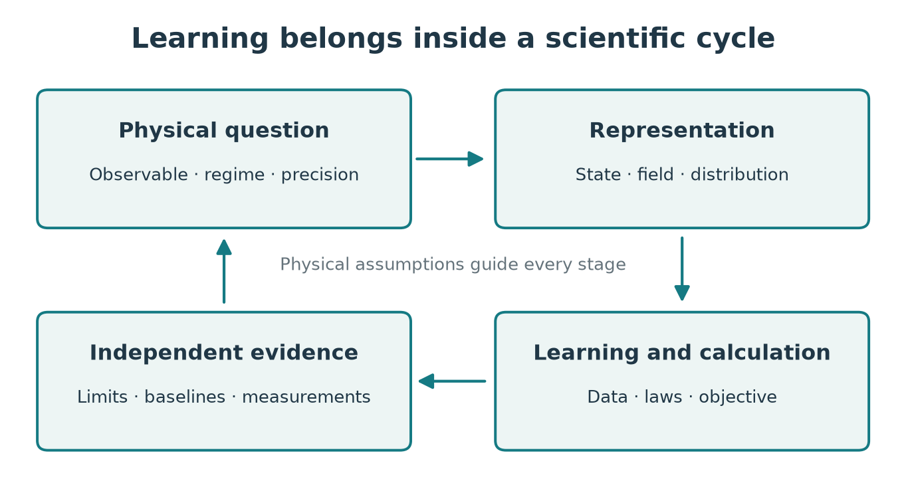

# What can learning contribute to physics? {#sec-questions}

## A problem before an algorithm

Suppose we want the ground-state energy of a magnet with one hundred spin-$1/2$ particles. The Hamiltonian may occupy one line, yet a general wavefunction has $2^{100}$ complex amplitudes. Alternatively, suppose a telescope produces millions of noisy images: evaluating a model for every possible cosmological parameter set may be too expensive. Or suppose each measurement on a quantum device takes an hour: choosing the next measurement becomes part of the scientific problem.

These are three different bottlenecks: representation, computation, and information acquisition. Machine learning supplies parameterized objects that adapt to examples or physical objectives. The scientific task determines what should be represented, what counts as an error, and how the result will be tested.

By the end of this chapter you should be able to formulate a learning problem, distinguish the major modes of learning, estimate the cost of replacing a calculation by a surrogate, and identify what additional evidence turns a prediction into a scientific claim. Only elementary mechanics and algebra are needed here; the next chapters develop the mathematical tools.

## Representation, information, objective, validation

A **model** is a mathematical object used to answer a question. Here we distinguish a physical model, such as a Hamiltonian, from a learned approximation, such as a function $f_\theta(x)$ with adjustable numbers $\theta=(\theta_1,\ldots,\theta_P)$. The input $x$ might be a configuration of atoms, an external field, or a time. The output might be an energy, a probability, or the full field on a grid. **Training** means adjusting $\theta$ to improve a specified objective.

Four decisions recur throughout this book.

1. **Representation:** which functions, states, or distributions can the model express?
2. **Information:** which observations, simulations, or exact physical relations constrain it?
3. **Objective:** which scalar quantity does the training algorithm minimize or maximize?
4. **Validation:** which independent tests show that it answers the physical question?

These choices interact. If a particle energy depends on pairwise distances, using distances as inputs builds in rotational invariance. If the output is a probability distribution, normalization and positivity constrain the representation. If the objective is a variational energy, an exact expectation obeys a bound, but a noisy estimate need not visibly obey it in every finite sample. Validation must know the distinction.

{#fig-learning-cycle}

### Worked formulation: a force law

Consider measured positions $x_i$ and forces $F_i$ near equilibrium. Hooke's law proposes $F=-kx$. A one-parameter learned approximation is $f_k(x)=-kx$. If each measured force has independent Gaussian noise of known standard deviation $\sigma$, the natural objective, apart from constants, is

$$
L(k)=\frac{1}{2\sigma^2}\sum_i(F_i+kx_i)^2.
$$ {#eq-questions-hooke-loss}

Differentiate every term: $\partial_k(F_i+kx_i)^2=2x_i(F_i+kx_i)$. Setting the resulting sum to zero gives

$$
\widehat k=-\frac{\sum_i x_iF_i}{\sum_i x_i^2},
$$

provided at least one $x_i$ is nonzero. The denominator is important physically: data taken only at equilibrium contain no information about stiffness.

Suppose the true law is $F=-kx-\lambda x^3$. A linear fit may work near $x=0$ and fail far away. Increasing training accuracy near zero does not remove that **model error**. Adding $x^3$ to the representation can reduce it, but estimating $\lambda$ requires displacements for which the cubic contribution is larger than the noise. Richer models do not create information absent from the experiment.

## The main kinds of learning

**Supervised learning** uses input–output pairs $(x_i,y_i)$. A model predicts labels, real numbers, images, or fields. Predicting energy from atomic positions is regression; assigning a detector event to one of several categories is classification. The word supervised refers to the availability of target outputs, not to a human watching the optimizer.

**Unsupervised learning** uses data without target labels. It can find directions of large variation, groups of similar configurations, or a probability distribution. The distinction is about the task: a generative model trained on measured snapshots can be unsupervised even though its training uses a precisely defined loss. If a clustering algorithm separates data from two temperatures, the separation might reflect magnetization, detector gain, or an irrelevant preparation artifact. Physical interpretation is an additional step.

**Self-supervised learning** constructs prediction targets from the data themselves. Hiding some sites in a spin snapshot and predicting them is one example. It can learn useful structure before scarce labeled measurements are available. Its objectives encode statistical relationships; whether these correspond to useful physical variables requires testing.

**Physics-based variational learning** minimizes a physical functional without a list of exact outputs. A wavefunction can be optimized by minimizing its Hamiltonian expectation. A field can be trained to satisfy a differential equation. Such procedures still need samples or quadrature points, boundary conditions, and numerical error control.

**Reinforcement learning** chooses actions that affect future observations and rewards. Adjusting magnetic coils to keep plasma in a target configuration is a sequential control problem. A policy maps available information to actions. The reward must reflect the experimental objective, and a simulator's inaccuracies can become dangerous control errors on the real apparatus. Chapter 18 develops this distinction from ordinary regression.

## Four physical uses of learned models

### Solving a known equation

When the law is established, learning can approximate a solution or an expensive subroutine. Examples include ground-state wavefunctions, electronic energies, and fluid solution operators. The relevant standard is accuracy and cost relative to a classical numerical method with the same physical assumptions. A method should be compared against the strongest appropriate baseline, not against an unnecessarily slow implementation.

### Inferring an unknown parameter or state

The law may be known but the initial state, coupling, material coefficient, or source is hidden. The forward map is $y=G(\vartheta)+\epsilon$, where $\vartheta$ denotes physical parameters and $\epsilon$ represents noise. Inferring $\vartheta$ from $y$ is an inverse problem. Two different parameter values can produce nearly identical measurements; then no predictor can reliably distinguish them without additional information. Chapter 17 turns this physical issue into a statement about singular values and posterior distributions.

### Finding useful collective variables

A large system may admit a lower-dimensional description. Temperature, order parameters, reaction coordinates, and hydrodynamic densities summarize many microscopic variables. A learned coordinate is valuable if its dynamics or response are simpler and it remains meaningful across relevant conditions. Compressing data alone does not establish that it is a closed dynamical variable: unresolved degrees of freedom can introduce memory and noise.

### Discovering a relationship or designing an intervention

Equation discovery proposes compact mathematical relationships from observations. Active learning and experimental design choose which observations to collect. The strongest scientific use often combines the two: propose a relation, find where candidate relations disagree, and measure there. An automated process can execute this loop, while the meaning of novelty, acceptable uncertainty, and physical admissibility still has to be specified.

## Cost, scale, and amortization

A learned surrogate often moves work from evaluation to training. Let an exact calculation cost $C_{\mathrm{exact}}$, training data and fitting together cost $C_{\mathrm{train}}$, and one surrogate call cost $C_{\mathrm{pred}}$. After $M$ queries the two costs are

$$
C_{\mathrm{direct}}=M C_{\mathrm{exact}},\qquad
C_{\mathrm{surrogate}}=C_{\mathrm{train}}+M C_{\mathrm{pred}}.
$$

If $C_{\mathrm{exact}}>C_{\mathrm{pred}}$, the nominal break-even point is

$$
M>\frac{C_{\mathrm{train}}}{C_{\mathrm{exact}}-C_{\mathrm{pred}}}.
$$ {#eq-questions-break-even}

This is **amortization**: paying once to reduce the cost of repeated tasks. The comparison omits validation, failure recovery, hardware changes, and queries outside the trained domain; those costs should be included in a real study. A surrogate may have no advantage for a single query, yet enable an otherwise impossible parameter scan.

For example, let an electronic calculation cost 30 minutes, training cost 300 hours, and prediction cost 0.1 seconds. Ignoring overhead, the break-even point is just over 600 queries. If the model requires ten new training calculations whenever the material changes, the claimed advantage depends on how often that change occurs.

```{python}
exact_seconds = 30 * 60
training_seconds = 300 * 3600
prediction_seconds = 0.1
break_even = training_seconds / (exact_seconds - prediction_seconds)
assert 600 < break_even < 601
print(f"Break-even: {break_even:.2f} queries")
```

## Why high dimension is difficult, and when structure helps

If a function of $d$ variables is represented on a grid with $m$ points per coordinate, the grid has $m^d$ values. Even $m=10$, $d=30$ is impossible to store directly. This exponential growth is one version of the **curse of dimensionality**.

Physics offers structure: locality, symmetry, low entanglement in some states, separation of scales, conservation laws, and sparse interactions. A neural network can exploit some of that structure, especially when its architecture reflects it. It cannot efficiently represent, train on, and sample every possible high-dimensional object. A parameter count growing as a power of system size describes a restricted family, however expressive that family may be on relevant systems.

It helps to separate three questions. **Expressivity** asks whether a good approximation exists within the model family. **Optimization** asks whether our algorithm can find it. **Statistical efficiency** asks whether available information distinguishes it from poor approximations. For generative methods, **sampling efficiency** adds a fourth question. A proof about one does not automatically answer the others.

## Research bridge: prediction, representation, and evidence

The review by Carleo and collaborators maps many connections between machine learning and physical science [@f-carleo-review]. The present book uses a question-based curriculum: state representation, dynamics, inference, and discovery share tools but require different evidence.

Phase recognition provides an accessible example. Supervised networks were shown to distinguish phases from configurations in specified models [@f-carrasquilla]. Principal-component approaches demonstrated that simple unsupervised coordinates can track familiar ordering structures [@f-wang]. The confusion scheme uses deliberately changed labels and the resulting classification performance to propose a boundary [@f-confusion]. These are complementary numerical strategies, not general proofs that a phase transition can be identified from arbitrary data. Finite-size scaling, symmetry, observables, and independent checks remain necessary. Chapter 3 derives an elementary version of the underlying statistical ideas.

## Exercises and worked answers

1. **A meaningful target.** You are given trajectories of pendulums with different lengths and unknown camera scales. Formulate a supervised task and identify a variable that could let the model cheat.
2. **Break-even.** A solver costs 10 seconds per query; a surrogate costs 0.01 seconds and needs 100,000 seconds to train. How many queries are needed to break even?
3. **Physical constraints.** A learned interatomic energy changes when every atom is translated by the same vector. Which physical property is violated? What would testing only one fixed center of mass miss?
4. **Representation versus optimization.** A model family contains the exact ground state, but training repeatedly converges to a poor energy. List two logically distinct explanations.

**Selected answers.** (1) Predict oscillation frequency from calibrated trajectories or dimensionless temporal features. A camera scale correlated with length can become a shortcut that fails on a new camera. Holding out an entire camera setup tests that possibility. (2) Require $M>100000/9.99=10010.01\ldots$, so 10,011 integer queries. (3) Translation invariance fails for an isolated system without external fields; tests confined to one center of mass do not probe that transformation. External traps require a different invariance statement. (4) The optimizer may be trapped or poorly conditioned; noisy or biased objective estimates may drive it incorrectly. Expressivity alone excludes neither explanation.

The next chapter develops the mathematical language needed to turn these formulations into calculable algorithms.
