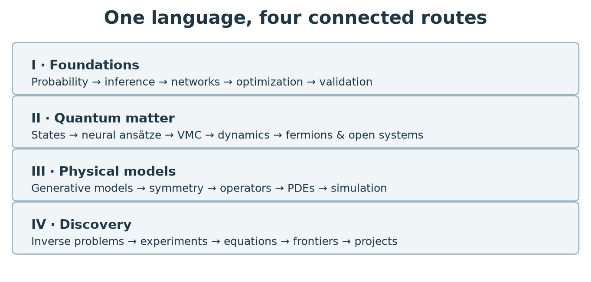

# About this book {.unnumbered}

::: {.hero}
::: {.book-kicker}
An open textbook · Theory, algorithms, and experiments
:::

Physics asks what can happen, why it happens, and what measurements would change our minds. Artificial intelligence adds adaptable representations and powerful tools for answering those questions. This book develops the mathematics and computational practice needed to use those tools critically.
:::

## What you will learn {.unnumbered}

The central theme is **learning under physical constraints**. A neural wavefunction, an interatomic potential, a surrogate fluid solver, and an automated experiment appear different. Each chooses a representation, uses information to determine it, and must demonstrate that its predictions answer a physical question. We develop those common ingredients before treating the distinctive physics of each application.

The book assumes undergraduate calculus, elementary linear algebra, classical mechanics, introductory statistical mechanics, and introductory quantum mechanics. It reviews the particular tools it uses, including probability, singular values, stochastic estimation, neural networks, automatic differentiation, variational geometry, symmetry, Bayesian inference, and experimental design. No previous machine-learning course is required. Optional advanced sections separate additional depth from the main route.

{#fig-curriculum}

The chapters contain derivations, worked calculations, original numerical demonstrations, exercises, and selected worked solutions. Executable Python examples use small, reproducible systems so that the mathematical idea remains visible. Research-scale software and primary papers appear in research bridges after the necessary concepts have been developed. Reading those sources is an opportunity for further study, not a prerequisite for understanding the chapter.

::: {.route-grid}
::: {.route-card}
### I · Foundations

[Start with physical questions](01-physical-questions.qmd), then learn probability, inference, networks, optimization, and uncertainty. These chapters establish the language used everywhere else.
:::
::: {.route-card}
### II · Quantum matter

[Enter the many-body problem](07-quantum-foundations.qmd): wavefunction compression, sampling, variational optimization, dynamics, fermions, and open systems.
:::
::: {.route-card}
### III · Physical structure

[Learn distributions and fields](12-generative-statistical-physics.qmd), then build symmetry into graphs, operators, differential equations, and differentiable simulators.
:::
::: {.route-card}
### IV · Discovery

[Infer hidden physics](17-inverse-problems.qmd), design experiments, recover equations, assess frontiers, and complete independent computational projects.
:::
:::

## How to study this book {.unnumbered}

For a first reading, follow Part I in order. Quantum readers can then follow Part II; readers interested in fluids or materials can follow Part III. The inverse-problem and discovery chapters use ideas from both routes but explicitly introduce their specialized tools. A first semester can cover Chapters 1–9 and one application chapter. A second semester can combine dynamics, symmetry, operators, inference, and a project. These are study routes, not claims that every topic can be mastered at the same speed.

Read a derivation with a pencil before running its code. Predict the sign, scale, symmetry, and limiting behavior of each result. Then change one assumption: reduce the data, increase system size, introduce measurement noise, or evaluate outside the training regime. A failed method is often the best demonstration of which assumption mattered.

Exercises marked **advanced** are optional. Solutions follow the exercise sections so that independent readers can check their reasoning. The [computational laboratory guide](computational-labs.qmd) provides downloadable notebooks, installation commands, and the exact reproduction workflow. The [notation reference](notation.qmd) explains conventions. The [literature and reproducibility appendix](literature-and-reproducibility.qmd) states how research claims and external implementations are handled.

## What counts as progress? {.unnumbered}

A faster approximation is useful when its error is understood and it changes the scale of a calculation we can perform. A learned representation is scientifically useful when it reveals a stable structure or makes a previously inaccessible prediction. A proposed discovery needs additional evidence: independent verification, a physical interpretation, and tests capable of rejecting it.

Throughout the book, **established statements** follow from specified assumptions or well-tested physical laws; **numerical observations** describe results in particular experiments; and **conjectures** identify plausible generalizations that still require evidence. Learning a finite dataset does not establish a law. Representing a wavefunction does not prove that it can be optimized or sampled efficiently. A predictive correlation does not establish a causal mechanism.

The field is broad, and this is a coherent textbook rather than an exhaustive encyclopedia. Quantum many-body physics receives sustained treatment. Particle physics, astrophysics, plasma physics, materials, and Earth-system modeling supply additional examples and research comparisons. The emphasis is on tools that transfer between those areas and on questions readers can investigate independently.

## Edition and openness {.unnumbered}

This edition is dated **21 October 2026**. Its research bridges include verified literature through that date where relevant; a paper's absence does not imply lesser importance. The narrative is organized by scientific problems rather than by researchers or institutions. Sources are cited at the claims they support. All textbook diagrams and teaching code are original to this project; no publisher figures have been reproduced.

Text and figures are available under [CC BY 4.0](https://creativecommons.org/licenses/by/4.0/); teaching code is available under the MIT license. External articles, datasets, and software retain their own licenses. Computational checks validate the demonstrations and specified identities; they do not constitute independent experimental confirmation of every cited research result.

Begin with [the physical questions](01-physical-questions.qmd).
